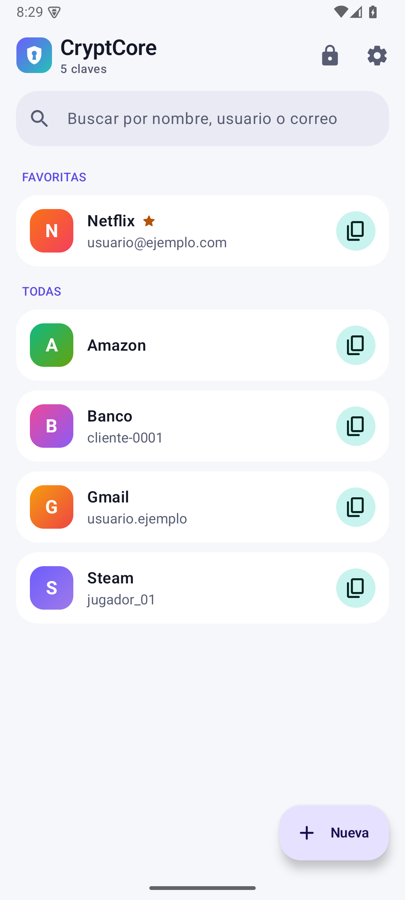
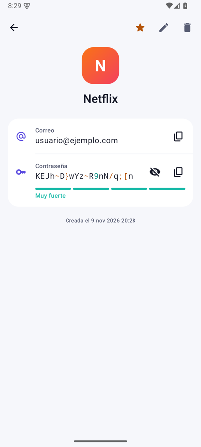
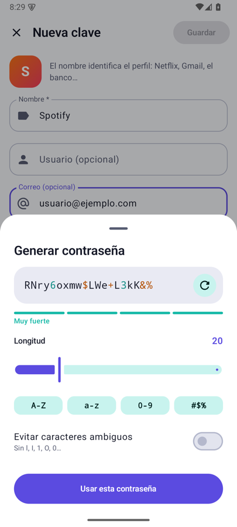
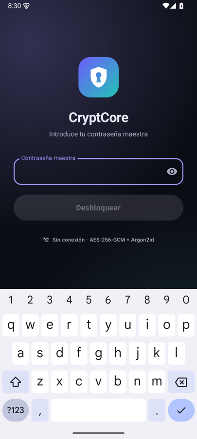

# CryptCore

Gestor de contraseñas para Android, **100 % offline**. Tus claves se guardan cifradas en el
propio teléfono y la app ni siquiera tiene permiso de Internet.

<p>
  
  
  
  
</p>

## Funciones

- Perfiles por web o app (Netflix, Gmail…): nombre, usuario y correo opcionales, contraseña,
  web y notas.
- Desbloqueo con contraseña maestra y, opcionalmente, con huella o rostro (biometría de clase fuerte).
- Si usas la huella, cada cierto tiempo (por defecto cada semana; configurable a 1, 5, 7, 10 o 20 días)
  se pide la contraseña maestra para que no se te olvide.
- Generador de contraseñas (longitud, tipos de carácter, evitar caracteres ambiguos) y medidor de fortaleza.
- Búsqueda (sin distinguir acentos), favoritas y copiar con un toque.
- El portapapeles se borra solo (configurable) y la copia se marca como sensible, así que el aviso
  de Android 13+ la oculta. Algunos teclados, como Gboard, pueden sugerirla igualmente hasta que se borra.
- Bloqueo automático al pasar a segundo plano (configurable).
- Copia de seguridad cifrada para exportar o importar (fusiona por perfil, se queda la versión más reciente).
- Tema claro, oscuro o del sistema, y Material You opcional.

## Seguridad

| Qué | Cómo |
| --- | --- |
| Derivación de clave | Argon2id (46 MiB, 2 pasadas) con sal aleatoria de 16 bytes |
| Cifrado | AES-256-GCM. Una clave de datos aleatoria cifra el almacén y la contraseña maestra solo envuelve esa clave |
| Biometría | Una clave AES del Android Keystore (en hardware) que solo se usa tras una huella válida envuelve una copia de la clave de datos. Si registras una huella nueva, se invalida |
| Red | `INTERNET` eliminado del manifest final (`tools:node="remove"`), así que la app no puede conectarse a nada |
| Copias de Android | `allowBackup=false` y reglas de extracción vacías. El almacén vive en `noBackupFilesDir` |
| Pantalla | `FLAG_SECURE`: no permite capturas ni grabación, y la miniatura de recientes sale en blanco. Además ignora toques cuando otra app dibuja encima |
| Memoria | La clave se borra de RAM al bloquear. Los textos ya descifrados viven en objetos `String` de la JVM y no se pueden sobrescribir; es una limitación de cualquier app Java/Kotlin |

**Si olvidas la contraseña maestra no hay recuperación posible.** Exporta copias de vez en cuando.

### Actualizaciones

Como la app no tiene red, «Buscar actualizaciones» (en Ajustes) abre la página de
[releases](https://github.com/byLuisMoya/CryptCore/releases/latest) en tu navegador. Es el navegador
el que se conecta, no CryptCore.

## Compilar

Requisitos: JDK 17 y Android SDK 35.

```bash
./gradlew testDebugUnitTest assembleDebug     # APK de depuración (id .debug, puede convivir con la release)
./gradlew assembleRelease                     # APK de release (firmado si hay keystore)
```

Para capturas de pantalla (la app las bloquea con `FLAG_SECURE`), compila con
`-Pcryptcore.allowScreenshots=true`. Nunca publiques un APK compilado así.

### Firma de la release

1. Crea la clave una sola vez y **guárdala bien**: si la pierdes, los usuarios tendrán que desinstalar para actualizar.
   ```bash
   keytool -genkeypair -v -keystore cryptcore-release.jks -alias cryptcore \
           -keyalg RSA -keysize 4096 -validity 10000
   ```
2. En local, crea `keystore.properties` en la raíz (ya está en `.gitignore`):
   ```properties
   storeFile=cryptcore-release.jks
   storePassword=...
   keyAlias=cryptcore
   keyPassword=...
   ```
3. En GitHub, añade estos secretos: `CRYPTCORE_KEYSTORE_BASE64` (`base64 -i cryptcore-release.jks`),
   `CRYPTCORE_KEYSTORE_PASSWORD`, `CRYPTCORE_KEY_ALIAS` y `CRYPTCORE_KEY_PASSWORD`.
4. Sube la versión (`versionCode`/`versionName` en `app/build.gradle.kts`) y publica un tag:
   ```bash
   git tag v1.0.0 && git push origin v1.0.0
   ```
   El workflow `Release` compila, firma y publica el APK junto con su SHA-256.

## Estructura

```
app/src/main/java/io/github/byluismoya/cryptcore/
├── crypto/VaultCodec.kt        formato del almacén, Argon2id + AES-GCM (Kotlin puro y testeado)
├── data/                       modelos, repositorio cifrado y preferencias
├── security/                   biometría (Keystore), portapapeles seguro y autobloqueo
├── core/                       generador y medidor de contraseñas
└── ui/                         Jetpack Compose (Material 3)
```
